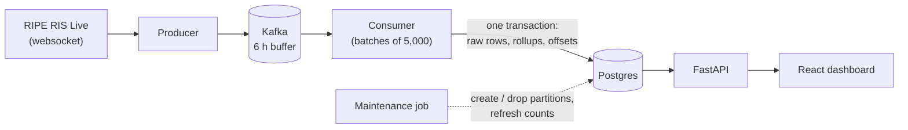

# Interdomain

Real-time BGP routing observability. It streams live routing updates from
[RIPE RIS Live](https://ris-live.ripe.net/), stores them in Postgres, and shows
routing health on a dashboard.

BGP is how networks (autonomous systems) tell each other which IP prefixes they
can reach. An *announcement* says "I can reach this prefix"; a *withdrawal* says
"I no longer can". Watching those updates shows outages, instability and
(eventually) hijacks as they happen.

## Architecture



| Piece | Job |
|---|---|
| Producer | Reads the websocket and publishes each event to Kafka. Reconnects with exponential backoff and jitter. |
| Kafka | Durable buffer between a feed that cannot be paused and a database that sometimes is slow. |
| Consumer | Reads batches, writes raw events and per-minute rollups. Stores its Kafka offset in Postgres, in the same transaction as the data. |
| Postgres | Raw events in hourly partitions, plus small rollup tables the dashboard reads. |
| Maintenance | Creates future partitions, drops expired ones, refreshes distinct-prefix counts. Guarded by an advisory lock so only one runs. |
| FastAPI + React | A read layer over the rollups, and a dashboard that polls it. |

## Design decisions

- **Offsets live in Postgres, not Kafka.** Data and position commit together, so
  a crash replays a batch and never double counts. On startup the stored offset
  is checked against what Kafka still holds; a gap is logged, not skipped silently.
- **The dashboard reads rollups, never raw events.** At the current feed rate
  (about 500,000 rows a minute) the raw table grows by roughly 9 GB an hour, while
  the per-minute rollup is about 450 rows a minute.
- **Retention is `DROP TABLE` on hourly partitions.** Instant, and the disk is
  returned immediately, unlike a `DELETE` of millions of rows.
- **The Kafka producer is idempotent** (`enable.idempotence`), so retries cannot
  create duplicates. Delivery is confirmed through callbacks and counted.
- **Schema changes are versioned migrations** tracked in a `schema_migrations` table.
- **No secrets in code.** The database password comes from `.env`; services bind
  to localhost.

## Quick start

Requires Python 3.13, Node 22 and Docker.

```bash
python -m venv .venv
# Windows: .venv\Scripts\activate    macOS/Linux: source .venv/bin/activate
pip install -r requirements-dev.txt

cp .env.example .env        # then set POSTGRES_PASSWORD
docker compose up -d postgres kafka
python scripts/init_db.py   # creates the tables

python scripts/run_producer.py      # terminal 1
python scripts/run_consumer.py      # terminal 2
python scripts/run_maintenance.py   # terminal 3

uvicorn interdomain.api.main:app --app-dir src --reload   # terminal 4
cd frontend && npm ci && npm run dev                      # terminal 5
```

To run everything in containers instead (migrations, producer, consumer,
maintenance, API and the dashboard behind nginx):

```bash
docker compose --profile app up -d --build
# dashboard: http://127.0.0.1:8080
```

Do not run the containerized and local consumers at the same time: they share
one Kafka consumer group, and the topic has a single partition.

On Windows, `scripts\dev.ps1` starts all of the local version in separate windows
(`-Spark` also starts the Spark prototype). The API docs are at
`http://127.0.0.1:8000/docs` and the dashboard at `http://localhost:5173`.

`scripts/pipeline_stats.py` prints API latency, table sizes, ingest rate and
consumer lag.

## Tests

```bash
python -m pytest
```

The tests cover pure logic with fakes (normalization, rollups, batch decoding,
backoff, producer queue handling, offset resume rules, migration planning). They
need no database or Kafka. CI also lints and builds the frontend.

## Storage

- `bgp_events`: raw events in hourly partitions, kept `RAW_RETENTION_HOURS`
  (default 2; whole partitions are dropped, so 2 to 3 hours are held).
- `bgp_minute_stats`: per-minute announcement and withdrawal counts by collector
  and peer ASN, kept `ROLLUP_RETENTION_DAYS` (default 7).
- `bgp_prefix_seen` / `bgp_prefix_counts`: exact distinct-prefix counts for the
  last hour, refreshed every 30 seconds.
- `kafka_offsets`: the consumer's position, committed with the data. To skip
  ahead in Kafka, update this row; resetting the Kafka consumer group has no effect.

Regions and countries describe where RIPE collectors are located, not where the
affected prefixes are.

## Status and limits

What exists: ingestion, the Kafka pipeline, storage and retention, an API, and a
dashboard showing withdrawal and announcement activity by collector and region.

What does not exist yet:

- **Hijack and leak detection.** The only signal today is withdrawal rate. There
  is no origin tracking, MOAS detection or RPKI validation, and no stored alerts.
- **Deployment.** It runs locally with Docker for Postgres and Kafka.
- `spark/bgp_stream.py` is a prototype that prints to the console; nothing uses it.

The plan is in [docs/roadmap.md](docs/roadmap.md).

## Related work

[BGPalerter](https://github.com/nttgin/BGPalerter) and
[ARTEMIS](https://github.com/FORTH-ICS-INSPIRE/artemis) already detect hijacks
in real time and are far more complete. Interdomain is a learning project
focused on the streaming data pipeline, storage design and, later, explaining
detected events.
